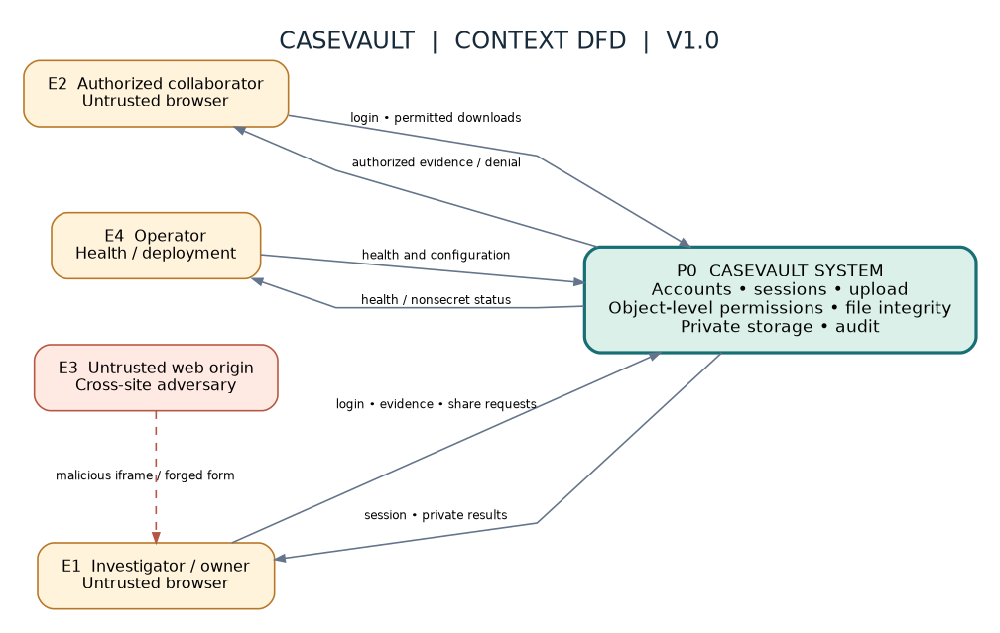
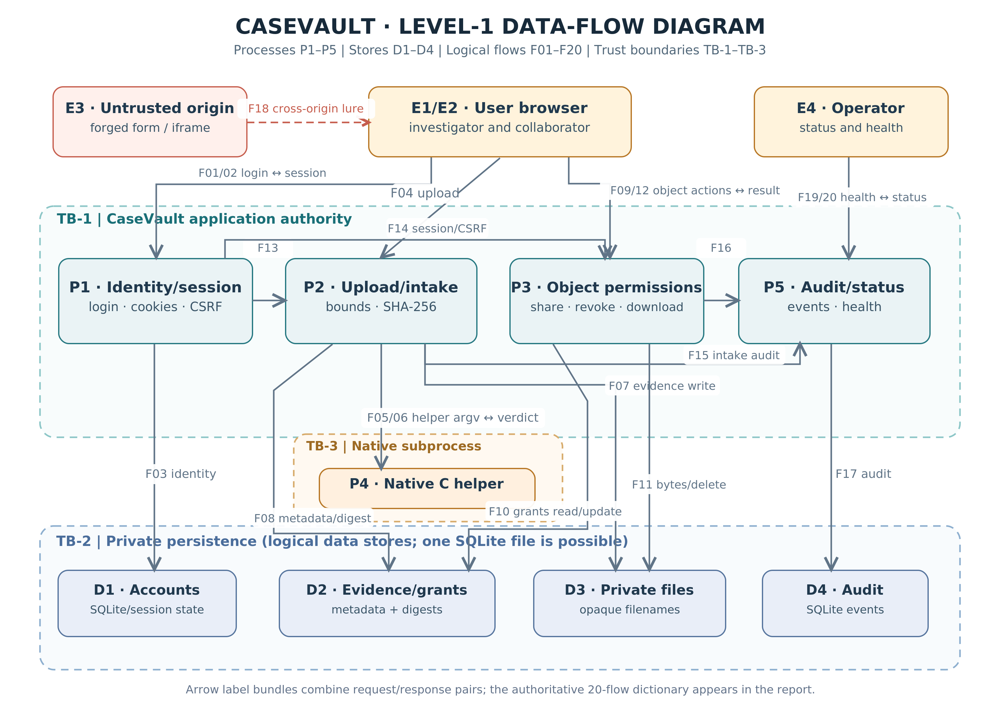
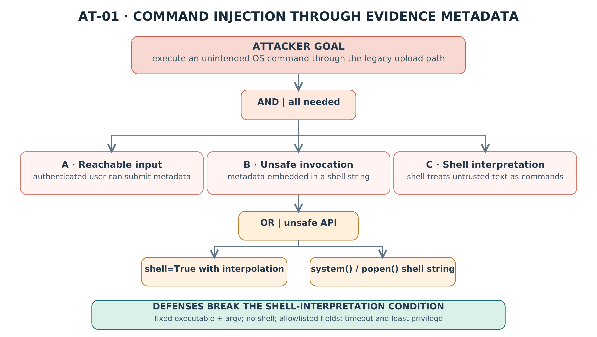
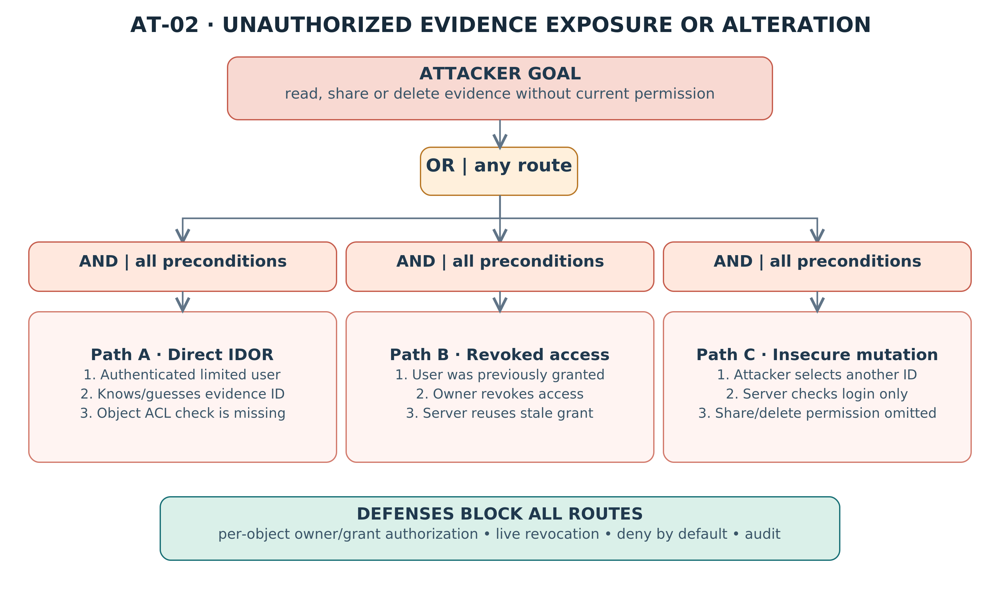

# CASEVAULT | THREAT MODEL & QUANTITATIVE RISK ASSESSMENT

**CYC386 — Secure Software Design and Development**  ·  **Midterm Lab Security Engineering Sprint (Fall 2026)**

**Version:** 1.0  ·  **Prepared:** 2026-10-30  ·  **Status:** Design threat model; project implementation/testing and instructor approval confirmation pending

**Team:** [Insert actual team name, members and instructor approval record]

> **Evidence authenticity:** This is a design-time model based on the locked CaseVault architecture and Phase 2 PNE requirements. Scores are for *hypothesized vulnerable conditions*, not confirmed findings. Actual Jira keys, pull requests, tool logs and before/after screenshots will be entered only when generated.

## 1. Executive security summary

CaseVault is a browser-based incident-evidence sharing platform with session authentication, owner/grantee authorization, a native C metadata validator, private file storage, SHA-256 digest verification and audit records. This model evaluates 36 DFD elements/boundaries/flows, 26 STRIDE threat scenarios and 16 hypothetical software-weakness risk scenarios using FIRST CVSS v3.1. It contains two attack trees, a PNE-linked risk register, and a separate qualitative residual-risk register. No attack has been claimed as reproduced in the application yet.

**Design priority:** address unauthorized file access, untrusted native/shell processing, CSRF, clickjacking and bounds failures before release; also protect audit and CI evidence.

## 2. Scope, actors, assets and trust boundaries

**Runtime:** local Docker-hosted FastAPI/Jinja2 app; browser login/logout; bounded upload; SHA-256; grants/revokes; downloads/delete; C metadata helper via subprocess; SQLite logical stores and private directory. No public share links, enterprise SSO or internet production deployment assumed.

**Actors:** E1 investigator/owner browser (E2 collaborator is the same boundary in Level-1), E3 hostile external website used to model forged cross-origin actions, E4 operator. The attacker may be unauthenticated, a limited authenticated user or a cross-origin page; operator is not automatically entitled to browse evidence.

**Boundaries:** TB-1 browser ↔ web app; TB-2 app ↔ private DB/files; TB-3 app ↔ isolated native C subprocess. Source/CI risk (A-14) is reviewed separately from runtime flows.

**Source IDs:** Phase 2 `PNE-001…PNE-030`, `SR-001…SR-030`, `T-001…T-030`; Phase 3 `TH-001…TH-026`, `R-01…R-18`. The asset IDs and CIA assumptions are unchanged from Phase 2.

## 3. Data-flow diagrams

### 3.1 Context DFD (Figure 1)

The context draws the entire application as P0; storage and helper are internal. Sensitive browser requests and responses cross TB-1. The malicious origin can influence the user browser but has no direct privileged connection to the application.

### 3.2 Level-1 DFD (Figure 2)

**Important modeling detail:** Logical SQLite stores D1, D2, D4 may be implemented in one physical SQLite file. The split identifies distinct security interests, not separate database servers. In a Level-1 flow E1 represents owner and collaborator browsers from the context view.

### 3.3 Data-flow inventory

| Flow | Source → destination | Payload / control |
|---|---|---|
| F01 | E1→P1 | Threats: TH-001, TH-002, TH-022 |
| F02 | P1→E1 | Threats: TH-001 |
| F03 | P1↔D1 | Threats: TH-001, TH-002 |
| F04 | E1→P2 | Threats: TH-003, TH-010, TH-015 |
| F05 | P2→P4 | Threats: TH-013, TH-014 |
| F06 | P4→P2 | Threats: TH-013, TH-019 |
| F07 | P2→D3 | Threats: TH-015, TH-016 |
| F08 | P2→D2 | Threats: TH-012, TH-016 |
| F09 | E1→P3 | Threats: TH-006, TH-007, TH-012 |
| F10 | P3↔D2 | Threats: TH-006, TH-011, TH-023 |
| F11 | P3↔D3 | Threats: TH-005, TH-007, TH-024 |
| F12 | P3→E1 | Threats: TH-005, TH-022 |
| F13 | P1→P2 | Threats: TH-001, TH-008 |
| F14 | P1→P3 | Threats: TH-001, TH-008, TH-006 |
| F15 | P2→P5 | Threats: TH-004, TH-017 |
| F16 | P3→P5 | Threats: TH-004, TH-017 |
| F17 | P5→D4 | Threats: TH-017, TH-018 |
| F18 | E3→E1 | Threats: TH-008, TH-009 |
| F19 | E4→P5 | Threats: TH-024 |
| F20 | P5→E4 | Threats: TH-018, TH-024 |

## 4. STRIDE analysis — complete element coverage

**Legend:** S Spoofing, T Tampering, R Repudiation, I Information disclosure, D Denial of service, E Elevation of privilege. `X` indicates a relevant threat-prompt for that element; `—` means not prioritized/applicable under the chosen DFD classification, not “secure.” Each element is covered, including F01–F20. Detailed scenarios and mitigations follow and are supplied as independent CSV files.

| DFD element / boundary | S | T | R | I | D | E | Threat IDs |
|---|:---:|:---:|:---:|:---:|:---:|:---:|---|
| E1 External entity: investigator/browser | X | — | X | X | — | X | TH-001, TH-008, TH-009 |
| E2 Role: authorized collaborator shares E1 browser boundary | X | — | X | X | — | X | TH-001, TH-006, TH-023 |
| E3 External entity: untrusted website | X | X | — | X | — | — | TH-008, TH-009 |
| E4 External entity: operator | X | — | X | X | — | — | TH-004, TH-018 |
| P1 Process: authentication and sessions | X | X | X | X | X | X | TH-001, TH-002, TH-008, TH-020 |
| P2 Process: intake and integrity | — | X | X | X | X | X | TH-003, TH-010, TH-015, TH-016 |
| P3 Process: evidence authorization | X | X | X | X | X | X | TH-004, TH-006, TH-007, TH-011, TH-023 |
| P4 Process: native metadata helper | — | X | — | X | X | X | TH-013, TH-014, TH-019, TH-026 |
| P5 Process: audit and status | — | X | X | X | X | — | TH-004, TH-017, TH-018, TH-024 |
| D1 Data store: users and sessions | — | X | X | X | X | — | TH-001, TH-002, TH-020 |
| D2 Data store: metadata, grants, digests | — | X | X | X | X | — | TH-006, TH-011, TH-012, TH-016, TH-023 |
| D3 Data store: private evidence bytes | — | X | X | X | X | — | TH-005, TH-007, TH-015, TH-024, TH-025 |
| D4 Data store: audit events | — | X | X | X | X | — | TH-017, TH-018 |
| TB-1 Boundary: browser to application | X | X | — | X | — | X | TH-001, TH-008, TH-009, TH-022 |
| TB-2 Boundary: application to persistence | — | X | — | X | — | X | TH-005, TH-006, TH-011, TH-015 |
| TB-3 Boundary: app to native helper | — | X | — | — | X | X | TH-013, TH-014, TH-019, TH-026 |
| F01 Flow: Credentials/cookies: E1→P1 | X | X | — | X | — | — | TH-001, TH-002, TH-022 |
| F02 Flow: Session/denial: P1→E1 | X | — | — | X | — | — | TH-001 |
| F03 Flow: Identity read/write: P1↔D1 | — | X | — | X | — | — | TH-001, TH-002 |
| F04 Flow: Evidence bytes/metadata: E1→P2 | — | X | — | — | X | — | TH-003, TH-010, TH-015 |
| F05 Flow: Validated argv: P2→P4 | — | X | — | — | — | X | TH-013, TH-014 |
| F06 Flow: Parser response: P4→P2 | — | X | — | — | X | — | TH-013, TH-019 |
| F07 Flow: Private write: P2→D3 | — | X | — | X | — | — | TH-015, TH-016 |
| F08 Flow: Metadata/digest write: P2→D2 | — | X | — | X | — | — | TH-012, TH-016 |
| F09 Flow: Object ID/actions: E1→P3 | X | X | — | — | — | X | TH-006, TH-007, TH-012 |
| F10 Flow: Grants/meta query: P3↔D2 | — | X | — | X | — | X | TH-006, TH-011, TH-023 |
| F11 Flow: Evidence bytes/delete: P3↔D3 | — | X | — | X | X | — | TH-005, TH-007, TH-024 |
| F12 Flow: Object result/denial: P3→E1 | — | — | — | X | — | — | TH-005, TH-022 |
| F13 Flow: Identity/CSRF verdict: P1→P2 | X | X | — | — | — | — | TH-001, TH-008 |
| F14 Flow: Identity/CSRF verdict: P1→P3 | X | X | — | — | — | X | TH-001, TH-008, TH-006 |
| F15 Flow: Intake audit event: P2→P5 | — | X | X | — | — | — | TH-004, TH-017 |
| F16 Flow: Object audit event: P3→P5 | — | X | X | — | — | — | TH-004, TH-017 |
| F17 Flow: Audit record: P5→D4 | — | X | X | X | — | — | TH-017, TH-018 |
| F18 Flow: Untrusted page: E3→E1 | X | X | — | — | — | X | TH-008, TH-009 |
| F19 Flow: Health req: E4→P5 | X | — | — | — | X | — | TH-024 |
| F20 Flow: Health reply: P5→E4 | — | — | — | X | — | — | TH-018, TH-024 |

### 4.1 Threat scenarios and mitigation expectations

| Threat | STRIDE | Element(s) | Abuse scenario | Proposed control / evidence test |
|---|:---:|---|---|---|
| TH-001 | S | P1/D1/F01,F02 | Session impersonation via weak signing secret or session misuse | Require strong secret, expiry and server check; verify altered cookie denied |
| TH-002 | S | P1/F01 | Credential stuffing or guessing | Vetted password hashing and monitoring/throttling |
| TH-003 | T | F04/P2 | Client alters upload metadata or declared size | Validate lengths and bytes on server |
| TH-004 | R | P3/P5/F16,F17 | User disputes share/delete due to missing event record | Record actor, object, action, outcome and timestamp |
| TH-005 | I | D3/P3/F11 | Private evidence leaked through direct static path | Server-only authorized download; private file store |
| TH-006 | E | P3/D2/F09,F10 | IDOR read/share access when object ACL not checked | Owner and grant checks on each operation |
| TH-007 | T | P3/D3/F11 | Non-owner deletes another investigator’s file | Owner-only delete and unchanged-data negative test |
| TH-008 | T | P1/P3/F18 | CSRF sensitive grant/revoke/delete | Anti-CSRF synchronizer token; SameSite; reject missing/wrong token |
| TH-009 | E | E3/E1/F18 | Clickjacking through framed authenticated UI | CSP frame-ancestors none; XFO DENY |
| TH-010 | D | P2/F04 | Oversized/repeated evidence uploads exhaust disk or worker | Request maximum, disk cleanup and health check |
| TH-011 | T | P3/D2/F10 | Dynamic SQL query construction allows input manipulation | Parameterized SQL, negative input test |
| TH-012 | I | D2/F09,F10 | Opaque ID or guessable path leaks evidence metadata | Generated opaque storage ID and server authorization |
| TH-013 | E | P4/F05,F06 | Native helper memory corruption via unbounded input | Bounded C input, ASAN and compiler hardening |
| TH-014 | E | P4/F05 | Shell interpretation of upload metadata invokes extra command | Fixed argv; no shell; allowlist |
| TH-015 | T | P2/D3/F04,F07 | Filename/path traversal writes outside private store | Opaque server-generated filesystem paths |
| TH-016 | T | D2/D3/P2 | Hash or file byte change not detected | Ingest digest + recompute before authorized use |
| TH-017 | R | P5/D4/F17 | Mutable local audit table tampered or missing events | Detailed audit, protected storage; later external immutable archive |
| TH-018 | I | P5/D4 | Logs or traceback expose credentials/evidence | Error sanitization and log redaction |
| TH-019 | D | P4/F06 | Malformed native-helper data crashes or stalls request | Process timeout, bounds and controlled error |
| TH-020 | D | P1/F01 | Automated login abuse depletes resources or guesses credentials | Monitor/rate limit (P1 deployment hardening) |
| TH-021 | T | A-14/CI | Unreviewed GitHub change bypasses security tests | Require protected branch, PR approval and fail-on-high critical gate |
| TH-022 | I | TB-1/F01,F12 | Remote plaintext traffic leaks sessions/evidence | HTTPS before internet exposure |
| TH-023 | E | P3/D2/F10 | Cached authorization persists after revoked share | Grant state checked at each request |
| TH-024 | D | D3/D2 | Disk/database loss prevents evidence recovery | Backup and restore drill before production |
| TH-025 | T | P3/D3 | Incorrect retention/delete semantics cause unexpected evidence loss | Document retention and deletion scope |
| TH-026 | E | P4/A-13 | Privileged helper or container magnifies compromise | Non-root user, minimum capabilities and private writable paths |

## 5. Attack trees — high-impact attacker goals

### 5.1 AT-01 Command injection via metadata (Figure 3)

**Goal (OR/AND):** An authenticated lab attacker can supply upload metadata AND a vulnerable implementation passes that metadata to a shell AND the shell interprets control characters; the shell invocation can occur through `shell=True` or `system()/popen()` as alternative unsafe designs. The fix removes interpretation by passing a fixed executable with an argument array and timeouts. This is an *analysis tree*, not proof of command execution.

**Trace:** TH-014 → R-01 → PNE-014 / SR-014 → planned T-014, CI regression and screenshot.

### 5.2 AT-02 Unauthorized evidence exposure or alteration (Figure 4)

**Goal (OR):** Direct IDOR read, stale grant after revocation, or forged share/delete request may expose/modify evidence. Each branch is an AND chain of preconditions (valid limited account or former grant; known ID or outdated authorization; absent permission control). A single centrally enforced current object-authorization check breaks these branches.

**Trace:** TH-006 / TH-007 / TH-023 → R-03 / R-04 / R-18 → PNE-001–004 → planned T-001–T-004.

## 6. CVSS v3.1 quantitative assessment

**Method:** Use the FIRST CVSS v3.1 Base metrics AV, AC, PR, UI, Scope and C/I/A impacts, applying the official formula. Scores describe *hypothetical vulnerable variants*; they are not measured exploitation results. Temporal/Environmental metrics are omitted until deployment/exploit maturity evidence exists; operational priorities additionally consider case data sensitivity, feasibility and compensating controls. Scope is unchanged unless a separate security authority is clearly affected. **Severity bands:** Critical 9.0–10.0; High 7.0–8.9; Medium 4.0–6.9; Low 0.1–3.9.

| Risk | Description (pre-fix assumption) | CVSS v3.1 vector | Score | Level |
|---|---|---|---:|---|
| R-01 | Shell command injection in legacy metadata processing | `CVSS:3.1/AV:N/AC:L/PR:L/UI:N/S:U/C:H/I:H/A:H` | 8.8 | High |
| R-07 | SQL injection in metadata queries | `CVSS:3.1/AV:N/AC:L/PR:L/UI:N/S:U/C:H/I:H/A:H` | 8.8 | High |
| R-08 | Filename/path traversal reaches private files | `CVSS:3.1/AV:N/AC:L/PR:L/UI:N/S:U/C:H/I:H/A:L` | 8.3 | High |
| R-03 | IDOR permits unauthorized read plus grant modification | `CVSS:3.1/AV:N/AC:L/PR:L/UI:N/S:U/C:H/I:H/A:N` | 8.1 | High |
| R-04 | IDOR permits unauthorized evidence delete | `CVSS:3.1/AV:N/AC:L/PR:L/UI:N/S:U/C:N/I:H/A:H` | 8.1 | High |
| R-05 | CSRF causes unauthorized grant or deletion | `CVSS:3.1/AV:N/AC:L/PR:N/UI:R/S:U/C:H/I:H/A:N` | 8.1 | High |
| R-02 | Native helper buffer overflow | `CVSS:3.1/AV:N/AC:H/PR:L/UI:N/S:U/C:H/I:H/A:H` | 7.5 | High |
| R-10 | Session forgery under weak secret | `CVSS:3.1/AV:N/AC:H/PR:N/UI:N/S:U/C:H/I:H/A:N` | 7.4 | High |
| R-15 | Missing authentication rate limit | `CVSS:3.1/AV:N/AC:H/PR:N/UI:N/S:U/C:H/I:H/A:N` | 7.4 | High |
| R-06 | Clickjacking causes victim action | `CVSS:3.1/AV:N/AC:L/PR:N/UI:R/S:U/C:L/I:H/A:N` | 7.1 | High |
| R-17 | Remote traffic intercept without TLS | `CVSS:3.1/AV:A/AC:L/PR:N/UI:N/S:U/C:H/I:L/A:N` | 7.1 | High |
| R-09 | Oversized upload exhausts storage or workers | `CVSS:3.1/AV:N/AC:L/PR:L/UI:N/S:U/C:N/I:N/A:H` | 6.5 | Medium |
| R-18 | Non-privileged read path bypasses revocation | `CVSS:3.1/AV:N/AC:L/PR:L/UI:N/S:U/C:H/I:N/A:N` | 6.5 | Medium |
| R-11 | Tampering with evidence not detected | `CVSS:3.1/AV:L/AC:L/PR:L/UI:N/S:U/C:N/I:H/A:N` | 5.5 | Medium |
| R-13 | Sensitive data leaked through error or audit log | `CVSS:3.1/AV:L/AC:L/PR:L/UI:N/S:U/C:H/I:N/A:N` | 5.5 | Medium |
| R-14 | Upload validator failure allows process termination | `CVSS:3.1/AV:N/AC:L/PR:L/UI:N/S:U/C:N/I:N/A:L` | 4.3 | Medium |

### 6.1 Justification for high/critical CVSS vectors

**R-01 (8.8 High) — Shell command injection in legacy metadata processing.** Authenticated attacker controls an upload field; if sent through the shell, code runs with service privileges. Scope U assumes app and helper run in one application security authority. Mitigation: Replace shell with argv array, fixed executable, input validation, timeout; least-privilege runtime Planned verification: T-014;T-020.

**R-07 (8.8 High) — SQL injection in metadata queries.** Untrusted string enters SQL if dynamic concatenation exists; network-reachable to authenticated user and can affect whole CaseVault data store. Mitigation: Parameterized statements and input validation Planned verification: T-019.

**R-08 (8.3 High) — Filename/path traversal reaches private files.** Authenticated upload controls filename; if reused as filesystem path, unintended private objects could be overwritten/read. Mitigation: Opaque paths generated by server; private store outside public root; normalization Planned verification: T-010;T-011;T-015.

**R-03 (8.1 High) — IDOR permits unauthorized read plus grant modification.** Authenticated unprivileged user manipulates evidence ID; absent object-level checks could expose files and modify grants; no assumed availability impact. Mitigation: Centralize owner/grantee checks for each object; live revocation; deny by default Planned verification: T-001;T-002;T-003.

**R-04 (8.1 High) — IDOR permits unauthorized evidence delete.** Authenticated user could delete another user’s evidence where ownership validation is absent; high integrity and availability impact. Mitigation: Owner-only deletion, transactional metadata+file cleanup and denial tests Planned verification: T-004.

**R-05 (8.1 High) — CSRF causes unauthorized grant or deletion.** Remote attacker needs a signed-in victim to visit attacker-controlled origin; attacker holds no CaseVault account. Assumes forged sensitive action changes grant state. Mitigation: Session-bound CSRF tokens, SameSite, POST-only state changes, Origin checks where relevant Planned verification: T-008.

**R-02 (7.5 High) — Native helper buffer overflow.** Authenticated upload reaches unsafe C buffer; memory exploitation is assumed to need additional heap/stack conditions (AC:H). Worst-case impact is modeled, not confirmed RCE. Mitigation: Enforce length limits in Python/C; bounded copy; ASAN; compiler hardening; isolate helper Planned verification: T-013;T-020.

**R-10 (7.4 High) — Session forgery under weak secret.** Network attacker needs exposed/guessable session signing secret; extra condition motivates AC:H, but high account compromise impact. Mitigation: High-entropy environment secret; signed expiry; HttpOnly, session invalidation Planned verification: T-005;T-006;T-007;T-021.

**R-15 (7.4 High) — Missing authentication rate limit.** Automated guessing needs correct credentials to succeed; account lockout/throttling is deployment hardening P1. Mitigation: Per-account/IP throttling, event monitoring, MFA if deployed externally Planned verification: T-028.

**R-06 (7.1 High) — Clickjacking causes victim action.** Requires victim click on framed authenticated UI, with potential unauthorized share; lower direct disclosure than direct IDOR. Mitigation: CSP frame-ancestors none and X-Frame-Options DENY; browser test Planned verification: T-009.

**R-17 (7.1 High) — Remote traffic intercept without TLS.** Adjacent network position assumed when deployed over plaintext HTTP; local HTTP is acceptable only in isolated lab. Mitigation: Terminate HTTPS in real deployment; Secure cookies and redirects Planned verification: T-026.

### 6.2 Medium risk interpretation

**R-09 (6.5 Medium).** Authenticated user sends repeated/large uploads if limits absent; potential serious service availability loss. Planned verification: T-012;T-024.

**R-18 (6.5 Medium).** Previously granted user can reuse stale authorization after revoke if service caches outdated permission checks. Planned verification: T-003.

**R-11 (5.5 Medium).** User with local write access could modify file bytes if digest verification not performed; local attack and existing access assumed. Planned verification: T-016.

**R-13 (5.5 Medium).** Local log reader with limited access could view accidentally printed tokens, paths or secret data. Planned verification: T-018.

**R-14 (4.3 Medium).** Malformed metadata triggers uncaught helper crash or unbounded wait; assumed partial uptime impact. Planned verification: T-020.

**Caution:** CVSS does not measure threat probability, safety of the implementation or organization-specific business impact. If a modeled condition is not implemented in any code path, it must not be reported as an active vulnerability. Recalculate after verifying exact privileges and impacts during later phases.

## 7. Prioritized risk register and remediation plan

Priority is assigned from Base score, protected evidence sensitivity, availability impact, and assessed exploit assumptions. Implement the five mandatory fixes even if their CVSS Base score is Medium. **All findings are currently modeled, not confirmed.**

| Priority | Risk(s) / threat | PNE / planned regression | Fix requirement |
|---|---|---|---|
| P0 | R-01 / TH-014 | PNE-014;PNE-020 / T-014;T-020 | Replace shell with argv array, fixed executable, input validation, timeout; least-privilege runtime |
| P0 | R-07 / TH-011 | PNE-019 / T-019 | Parameterized statements and input validation |
| P0 | R-08 / TH-015 | PNE-010;PNE-011;PNE-015 / T-010;T-011;T-015 | Opaque paths generated by server; private store outside public root; normalization |
| P0 | R-03 / TH-006 | PNE-001;PNE-002;PNE-003 / T-001;T-002;T-003 | Centralize owner/grantee checks for each object; live revocation; deny by default |
| P0 | R-04 / TH-007 | PNE-004 / T-004 | Owner-only deletion, transactional metadata+file cleanup and denial tests |
| P0 | R-05 / TH-008 | PNE-008 / T-008 | Session-bound CSRF tokens, SameSite, POST-only state changes, Origin checks where relevant |
| P0 | R-02 / TH-013 | PNE-013;PNE-020 / T-013;T-020 | Enforce length limits in Python/C; bounded copy; ASAN; compiler hardening; isolate helper |
| P0 | R-10 / TH-001 | PNE-005;PNE-006;PNE-007;PNE-021 / T-005;T-006;T-007;T-021 | High-entropy environment secret; signed expiry; HttpOnly, session invalidation |
| P0 | R-06 / TH-009 | PNE-009 / T-009 | CSP frame-ancestors none and X-Frame-Options DENY; browser test |
| P0 | R-09 / TH-010 | PNE-012;PNE-024 / T-012;T-024 | Bounded streaming, size quota and fail cleanup, health monitoring |
| P0 | R-11 / TH-016 | PNE-016 / T-016 | SHA-256 at ingest and recheck at download; protect metadata/digest |
| P0 | R-13 / TH-018 | PNE-018 / T-018 | Structured redaction, generic client errors, access-restricted logs |
| P0 | R-14 / TH-019 | PNE-020 / T-020 | Strict bounds, timeout, controlled nonzero error handling |

**Traceability record:** `PNE_Traceability_Updated.csv` adds TH IDs to all 30 Phase 2 PNE rows. `Jira_Threat_Tasks_Planned.csv` provides issue content, but the actual Jira key, real PR URL, test log and reviewer must be filled in from real systems. **Do not call the CSV import a completed board.**

## 8. Residual-risk register and release policy

**Current posture:** This is a design assessment. There is no proven post-fix residual score yet. The table below is *expected residual/operational risk if the 7-day MVP scope remains local-only*; actual acceptance requires owner/instructor approval and evidence.

| Risk | Impact / why outside current proof | Future control / owner decision |
|---|---|---|
| QUAL-01: DB/file loss without tested backups | Impact can be irreversible evidence loss; CVSS inapplicable without a defined software vulnerability | Backup plus restore drill |
| QUAL-02: Unagreed retention/disposal policy | Governance risk rather than software exploit | Document retention period and deletion scope |
| QUAL-03: Over-privileged container/native subprocess | Environmental consequence modifier; no single concrete exploitable flaw proved | Run helper non-root; drop capabilities; isolate file permissions |
| QUAL-04: Audit SQLite can be modified by host administrator | Mutable local audit cannot provide tamper-proof chain of custody | Forward to independent protected logging before production |
| QUAL-05: Unreviewed changes bypass pipeline enforcement | CI governance control weakness; not a measurable standalone product CVSS vulnerability | Protect main, use reviewed PRs and nonzero high/critical security gates |

Additional constraints: non-HTTPS local Docker cannot be called internet-production-ready; SQLite application-level audit can be altered by a privileged host user; SHA-256 alone does not prove origin or legal chain of custody; malicious file content scanning is not in MVP. Keep real evidence out of the student lab.

**Gate:** Do not deploy beyond isolated lab until P0 tests pass, all high/critical confirmed vulnerabilities have been fixed or explicitly risk-accepted by an authorized stakeholder, real SAST/DAST logs are retained, and high/critical CI gates work. Not all residual risk can be “resolved” by a clean vulnerability scanner.

## 9. Evidence and GitHub/Jira handoff

1. Save model sources + original diagram files in GitHub on a feature branch; link a reviewed PR to the PNE stories. Preserve genuine commit timestamps.

2. Run `python scripts/check_model_integrity.py` and save output to `model_integrity_log.txt` from your actual terminal. This validates references only and **is not** a security test.

3. Verify representative FIRST calculator values (especially R-01/R-02/R-03). Screenshot the calculator with vector and numeric base score. Preserve original vectors in CSV.

4. Create Jira TH task issues, linking parent PNE Story and R risk IDs. Screenshot issue detail and To Do/In Progress/Done board when populated. Blank actual fields are deliberate.

5. Capture a real team review decision and approval; no artificial reviewer signature or screenshot. Use `Evidence_Manifest.csv` to track original filenames, UTC/local capture dates, collector, and repository paths.

6. During implementation, supply isolated controlled before/after evidence for five mandatory vulnerabilities, native ASAN output, unit/CI job logs, DAST/SAST scanner reports and authenticated authorization tests. **Not claimed in Phase 3.**

## 10. QA crosswalk to exam Sections 4, 5 and 6.3

- Context DFD and Level-1 DFD: Figures 1–2 with explicit trust boundaries and 20 labeled runtime flows.

- Systematic STRIDE: 6 categories considered on every DFD element with a detailed 26-threat catalog.

- Attack Tree: two high-impact goal trees (Command Injection and IDOR), with OR/AND logic and traceable remediations.

- CVSS v3.1: vectors, numeric Base scores and specific justifications; risk register linked to PNE tests and planned Jira issues.

- Residual risks: local-only vs production distinction and no fabricated post-test sign-off.

## References

1. Course instructor: *CYC386 Midterm Lab Exam — 1-Week DevSecOps Security Sprint (Fall 2026)*, Sections 2–7.

2. CaseVault *Phase 1 Architecture Blueprint* (locked theme proposal) and *Phase 2 PNE_Report.md* (PNE IDs and CIA).

3. FIRST, *Common Vulnerability Scoring System v3.1 Specification*, https://www.first.org/cvss/v3.1/specification.document (accessed 2026-10-30).

4. OWASP, *Threat Modeling Cheat Sheet*, https://cheatsheetseries.owasp.org/cheatsheets/Threat_Modeling_Cheat_Sheet.html (accessed 2026-10-30).

5. Microsoft, *Threat Modeling*, https://learn.microsoft.com/en-us/azure/security/develop/threat-modeling-tool (conceptual STRIDE/DFD reference).
